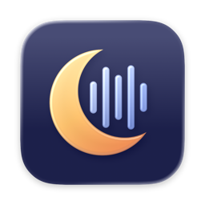

  

# Moonshift

**Give a song a whole new sound.**

Turn a song into a fresh cover, right on your Mac. Choose a style and a singer, and hear it performed anew.

[Download Moonshift](https://github.com/abradburne/moonshift/releases/latest)

## Make your first cover

1. **Add a song** and its lyrics.
2. **Pick a style and singer**, or describe the sound you have in mind.
3. **Create your cover**, listen, and export the takes you love.

Moonshift keeps your covers on your Mac. Once its models are installed, it works offline; online song and lyrics lookup is optional.

## Get started

You'll need a Mac with **Apple silicon**, **macOS 14 or later**, and about **7 GB** for the first download.

1. Download the [latest release](https://github.com/abradburne/moonshift/releases/latest).
2. Open the disk image and drag Moonshift into Applications.
3. Open Moonshift and follow the one-click setup to download its models.

Want more detail? See the [guide](docs/guide.md) for supported files, settings, building from source, and working with AI agents.

## License

Moonshift’s code is © 2026 Alan Bradburne and licensed under [GPL-3.0 or later](LICENSE), without warranty. The models and other components have their own terms, including non-commercial restrictions; see [third-party notices](THIRD_PARTY_NOTICES.md) before using them commercially.
